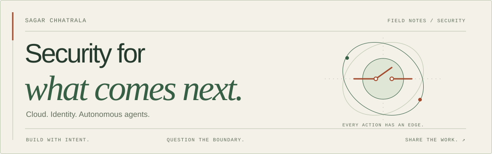
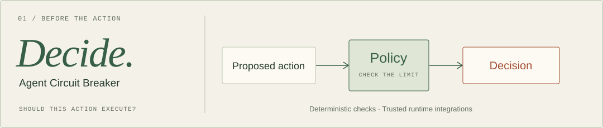
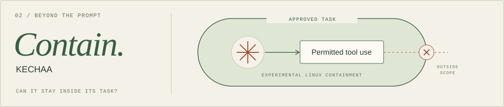
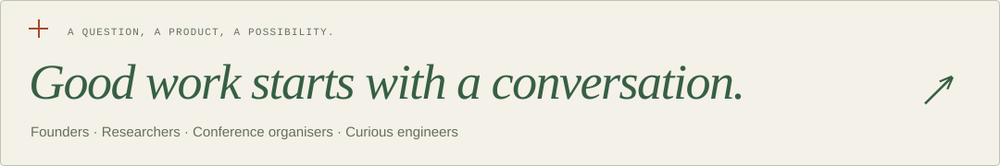

<a href="https://sagarchhatrala.github.io/">
  <picture>
    <source media="(prefers-color-scheme: dark)" srcset="./assets/header-dark.svg">
    <source media="(prefers-color-scheme: light)" srcset="./assets/header-light.svg">
    
  </picture>
</a>

<strong>I’m Sagar — a security engineer, researcher, and open-source builder.</strong>

I lead cloud and AI security at <strong>Greenlight</strong>. My independent work explores how to give autonomous agents explicit permissions, enforceable boundaries, and evidence we can inspect.

<a href="https://sagarchhatrala.github.io/"><strong>Step into my website ↗</strong></a> &nbsp; · &nbsp; <a href="https://sagarchhatrala.github.io/experience/">The story so far ↗</a> &nbsp; · &nbsp; <a href="mailto:chhatralasagar99@gmail.com">Let’s talk ↗</a>

<h2>The workbench</h2>

Different questions about the same problem: <strong>what should an autonomous system be allowed to do?</strong>

<a href="https://github.com/sagarchhatrala/agent-circuit-breaker">
  <picture>
    <source media="(prefers-color-scheme: dark)" srcset="./assets/acb-dark.svg">
    <source media="(prefers-color-scheme: light)" srcset="./assets/acb-light.svg">
    
  </picture>
</a>

<strong>Agent Circuit Breaker</strong> puts deterministic checks around agent actions. Trusted runtime integrations can add exact approvals and durable execution records.

CREATOR &amp; MAINTAINER &nbsp; / &nbsp; PUBLISHED PYTHON PACKAGE · BETA

<a href="https://github.com/sagarchhatrala/agent-circuit-breaker">Explore the source ↗</a> &nbsp; · &nbsp; <a href="https://sagarchhatrala.github.io/agent-circuit-breaker/">See the walkthrough ↗</a>

<pre><code>pip install agent-circuit-breaker</code></pre>

<a href="https://github.com/ruchithamohan/KECHAA-Kernel-Enforced-Containment-for-Hijacked-AI-Agents">
  <picture>
    <source media="(prefers-color-scheme: dark)" srcset="./assets/kechaa-dark.svg">
    <source media="(prefers-color-scheme: light)" srcset="./assets/kechaa-light.svg">
    
  </picture>
</a>

<strong>KECHAA</strong> explores how to keep agent tools within an approved task when instructions are hijacked, using signed permissions and experimental Linux containment.

DEVELOPER / RESEARCHER &nbsp; / &nbsp; RESEARCH PROTOTYPE · EXPERIMENTAL LINUX BACKEND

<a href="https://github.com/ruchithamohan/KECHAA-Kernel-Enforced-Containment-for-Hijacked-AI-Agents">Explore the research ↗</a>

<strong>Two more questions I’m exploring ↓</strong>

 

<strong>Did private context steer the result?</strong> 
<a href="https://github.com/sagarchhatrala/purpose-trace">PurposeTrace</a> compares agent executions to investigate unauthorized dependence on private context. Its scope is bounded offline audits and single-host CI release gates. 
<a href="https://sagarchhatrala.github.io/purpose-trace/">Explore the audit walkthrough ↗</a>

<strong>What risk accumulated along the way?</strong> 
<a href="https://github.com/sagarchhatrala/horizon-agent-containment">Horizon Agent Containment</a> is a research prototype that models state, provenance, authority, and relationships to examine emerging capabilities. 
<a href="https://sagarchhatrala.github.io/horizon-agent-containment/">Explore the recorded scenarios ↗</a>

<h2>From practice, back into practice.</h2>

I’ve worked across <strong>Intel → Cisco → Tenable → Greenlight</strong>. That experience informs the questions I bring to open source and to early-stage product teams.

<ul>
<li><strong>Advise:</strong> Rig Security — identity security across human, non-human, and AI-agent identities.</li>
<li><strong>Shape:</strong> AirMDR — early-stage design partner for AI-powered detection and response.</li>
<li><strong>Contribute:</strong> co-author of CIS benchmarks for AWS and Azure.</li>
</ul>

<strong>A few rooms where I’ve shared the work ↓</strong>

 
<ul>
<li><a href="https://lnkd.in/p/d_CBmKTd">CrowdStrike Fal.Con 2026</a> — cloud, data, and AI security.</li>
<li><a href="https://lnkd.in/p/dQHVsvSt">CrowdStrike Fal.Con 2025</a> — Removing Greenlight’s Blind Spots.</li>
<li><a href="https://aibuildersnetwork.org/conference/speakers/sagar-chhatrala">AI Builders Network</a> — conference speaker.</li>
<li>Cisco SecCon and OWASP Bangalore.</li>
</ul>

<a href="https://sagarchhatrala.github.io/experience/#speaking">Explore my speaking work ↗</a>

 
<a href="https://sagarchhatrala.github.io/#contact">
  <picture>
    <source media="(prefers-color-scheme: dark)" srcset="./assets/conversation-dark.svg">
    <source media="(prefers-color-scheme: light)" srcset="./assets/conversation-light.svg">
    
  </picture>
</a>

<a href="mailto:chhatralasagar99@gmail.com">Email ↗</a> &nbsp; · &nbsp; <a href="https://www.linkedin.com/in/sagarchhatrala">LinkedIn ↗</a> &nbsp; · &nbsp; <a href="https://sagarchhatrala.github.io/">Website ↗</a>

